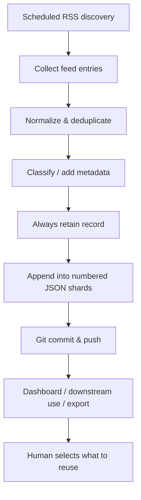

# 🌏 ICH Shared Heritage Radar
### Autonomous Intangible Cultural Heritage (ICH) Data Aggregator

> **Collect first. Preserve information. Let humans decide later.**

ICH Radar is a fully automated, free-tier-friendly discovery and collection pipeline for online information about Intangible Cultural Heritage (ICH). It continuously discovers sources, stores records, and enriches them when possible. It is intentionally **recall-first**: possible noise is acceptable; losing a potentially valuable heritage lead is not.

## Important notice: AI-assisted data mining, not verified facts

ICH Radar is an **automated AI-assisted scraper/data-mining and discovery tool**. It is intended to help users find, collect, organize, and enrich possible Intangible Cultural Heritage (ICH) information from publicly available web sources. It is **not a factual authority, official inventory, validation system, or substitute for expert/local knowledge**.

> **Use with caution. Extract the data, review the original source links, and manually select and verify what you intend to reuse.**

Records may be incomplete, inaccurate, duplicated, incorrectly located, misclassified, or generated/expanded by AI. A record's presence does not prove that the heritage element exists, is accurately described, is officially recognized, or is correctly attributed to a country or community. Direct thumbnail URLs may point to unrelated images, change, or have licensing/reuse restrictions.

The scraper operates autonomously without human approval. Human selection and verification happen downstream, outside this crawler. Treat all collected material as **research leads and raw data for further checking**, not ready-to-publish facts.

## Core principles

- **Autonomous:** scheduled collection runs without manual review or approval.
- **Preservation-first:** records are not discarded because a classifier thinks they are irrelevant or uncertain.
- **Recall-first:** when in doubt, retain the record and flag it as possible noise.
- **Append-first:** new information is added; existing records are not automatically deleted.
- **Deduplicate carefully:** repeated discovery of the same URL updates/merges the record rather than creating endless duplicates.
- **Identity-based merging:** records merge only when normalized heritage naming and explicit geographic location match exactly. Different locations remain separate; missing locations are never guessed into a merge.
- **Source preservation:** merged records retain unique source links and source-level snapshots, so enrichment does not erase provenance.
- **Optional free-tier AI:** Gemini identity extraction is capped at 20 attempts per run and merge-description calls happen only for matched records. If AI is unavailable or quota is exhausted, the crawler keeps records and appends distinct source descriptions instead.

- **Enrichment is optional:** AI/classification failure must not block collection.
- **Free by default:** scheduled aggregation does not require paid AI APIs or API-key top-ups.
- **Human decisions happen downstream:** ICH Radar is not a review, approval, or correction workflow. Use the collected data in other tools, then select/copy records as needed.

## What it collects

The current free collector uses public Google News RSS search feeds for multilingual ICH-related discovery. RSS is the discovery layer; the collector also attempts to follow article links and extract readable page text. Article extraction is best-effort (publisher blocks, paywalls, scripts, or unusual page structures may prevent extraction), and failures never discard the RSS record. A limited batch of up to 35 article fetch attempts is made per run to keep the workflow time and network use bounded. Records retain title, RSS description/snippet, source link, resolved URL when available, extracted article text, fetch status, publication date, collection timestamps, and informational classification metadata.

The feed coverage is only a starting point. Sources and query coverage may be expanded over time. A collected record is a lead—not a verified heritage inventory entry.

## Automated pipeline

**Classification never controls whether a record survives.** A record may be labeled `possible_noise`, `low_confidence`, or `unclassified`; these are informational hints only. No record is automatically rejected or deleted based on those labels.

## Storage & automatic sharding

The aggregator stores its collected records in numbered JSON shard files so one file does not grow indefinitely:

- `data1.json`
- `data2.json`
- `data3.json`
- …
- `data9999.json`

Each shard holds up to **500 records** by default. When a shard reaches its limit, the collector starts the next numbered file. Existing shard records are retained and loaded on the next run. The shard number is capped at 9999; the collector will fail safely rather than overwrite existing records if that cap is reached.

The legacy `free_discovery_candidates.json` file is retained as a compact run summary/manifest (counts, feed errors, timestamps), not as the growing master archive.

> Note: `data.json` is the existing legacy/dashboard inventory and is kept separate from the numbered aggregator archive files. The free scheduled collector does not overwrite it.

### Record contents

Each record can contain fields such as:

- `record_id`, `title`, `url`, `description`
- `publisher` / `source`, `published`, `first_collected_at`, `last_seen_at`
- `collection_method`, `category`, `relevance_score`, `confidence`
- `possible_noise`, `matched_terms`, and classifier notes

Fields may vary by source and by enrichment availability. Original source links are retained whenever provided. Article text extraction is not a complete web crawler and may return partial page text or no text.

## Schedule

GitHub Actions runs the free collector **daily at 00:00 UTC (07:00 Jakarta time)**.

The scheduled workflow:
1. Runs the RSS collector without requiring a Gemini key.
2. Collects records from the configured query feeds.
3. Deduplicates and retains historical records.
4. Writes/updates numbered shard files.
5. Commits changes automatically to the repository.

Manual workflow dispatch remains available for legacy Gemini-backed modes, but those are optional and are not required for scheduled collection.

## Direct thumbnail enrichment

Manual workflow mode **Thumbnail Enrichment (Direct URLs)** processes a bounded batch from the existing `data.json` inventory (default 5 records, configurable 1–25). It does not call AI APIs.

For each record missing a thumbnail, carrying a placeholder, or using a Microlink screenshot URL, the script tries source article pages in order and extracts representative image URLs from Open Graph/social metadata, JSON-LD, and HTML image attributes (including lazy-loaded and srcset variants). It validates candidate URLs with streamed HTTP requests, then falls back to Wikimedia Commons API search. Successful records retain the direct image URL, source page, extraction method, and checked timestamp. Existing direct thumbnail URLs are not overwritten. Records without a suitable image are marked `thumbnail_status=incomplete` and remain eligible for future retry.

The mode updates the existing main inventory without changing its summary counts or unrelated record fields. Image URLs are direct external links; availability and licensing remain source-dependent.

## Dashboard and exports

The dashboard is hosted through GitHub Pages. Existing dashboard features and legacy `data.json` inventory remain separate from the numbered collector archive unless explicitly integrated.

Collected JSON shards are designed to be reused by downstream tools. Humans can decide which records are useful and export or transform selected data into JSON, XML, or PDF through the relevant tools. ICH Radar itself does not require a human to correct or approve the collection.

## Data safety / limitations

- This is a **discovery archive**, not a verified or official ICH inventory.
- Automated metadata, categories, scores, summaries, and locations can be wrong.
- A noisy record is preferable to silently losing a possible ICH lead.
- URL duplicates are merged first. Heritage identity merging additionally requires exact normalized naming and location, and depends on AI extracting both fields; if either is missing, the records remain separate. This intentionally avoids risky merges.
- RSS feeds can change, become unavailable, or provide limited article text. Publisher full-text extraction is best-effort and is limited per run.
- The collector does not guarantee complete web coverage, full article access, or permanent preservation of publisher content.
- Collection respects reasonable request timeouts and avoids aggressive crawling. Publisher terms, robots policies, and copyright restrictions still apply; stored snippets/metadata and source links should be preferred over republishing entire copyrighted articles.

## Run manually

1. Open the repository's **Actions** tab.
2. Select **ICH Shared Heritage Auto-Crawler**.
3. Choose **Free Discovery (Experimental)**.
4. Click **Run workflow**.

The scheduled run already selects the free discovery mode. Manual execution is useful for testing or catching up.

## Repository

- **Website:** https://anggaconni.github.io/ICH-Radar/
- **Source:** https://github.com/AnggaConni/ICH-Radar

---

Built as a preservation-first, autonomous data collection experiment for living cultural heritage.
